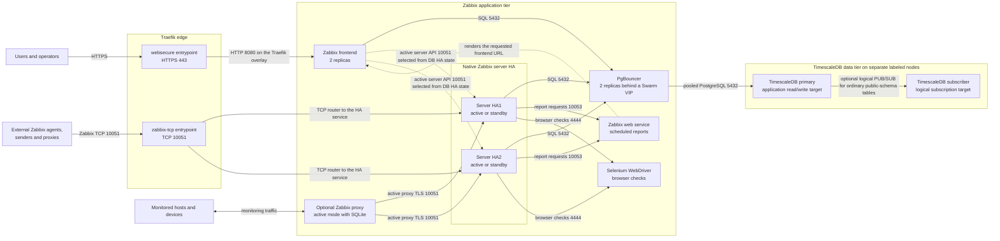

# Zabbix 7.0 HA on Docker Swarm with TimescaleDB and PgBouncer

This project deploys:

- two native Zabbix HA server nodes, forced onto different labeled Swarm nodes;
- two TimescaleDB instances on different labeled nodes;
- two PgBouncer replicas between every Zabbix application component and the primary database;
- a Traefik-routed Zabbix frontend with no directly published HTTP port;
- Zabbix web service, Selenium browser polling, and an optional SQLite proxy;
- optional PostgreSQL logical publication/subscription for ordinary public-schema tables from the primary to the subscriber.

The logical subscriber is not a complete database replica or an automatic failover solution. PgBouncer deliberately targets `timescaledb-primary`. PostgreSQL logical replication does not replicate DDL or sequence state, and native logical replication does not reliably follow TimescaleDB's dynamically created hypertable chunks. The bootstrap creates an initial Timescale-aware snapshot, but subsequent PUB/SUB should be treated as synchronization for ordinary tables only—not for Zabbix history, trends, or audit hypertables. Use physical streaming replication with a failover manager such as Patroni when a complete standby or automatic database failover is required.

## Architecture and application flow



Traefik is the external edge for both application paths: the `websecure` entrypoint routes HTTPS requests to the frontend, while the `zabbix-tcp` entrypoint accepts external Zabbix traffic on TCP port 10051 and forwards it to the HA server service. The optional in-cluster proxy remains on the backend overlay and connects directly to the configured HA server addresses.

The TCP route in the diagram is the intended edge flow. The current `ha_server.yml` still publishes the server ports directly and does not yet define the `zabbix-tcp` Traefik entrypoint/router labels; those deployment settings must be added before using Traefik for port 10051.

Both HA servers share the primary database through PgBouncer and coordinate their active/standby state through the database; there is no direct HA synchronization link between them. The frontend also uses the database HA state to reach the active server's `NodeAddress`. The logical subscriber is deliberately outside the application connection path and is not an automatic failover target.

## 1. Configure the environment

The committed `.env.example` contains every supported setting. The local `.env` is ignored by Git and contains configuration and Docker secret names only; password and private-key values are stored as Swarm secrets. PostgreSQL administration and Zabbix application credentials are separate, so the application does not connect as a database superuser. The defaults deliberately pair Zabbix 7.0.28 with TimescaleDB 2.27.2, which is inside the supported Zabbix 7.0 compatibility range; review that matrix before changing either image.

```bash
cp .env.example .env
chmod +x deploy.sh generateCertificates.sh scripts/*.sh
```

At minimum, edit these values:

- `ZABBIX_FRONTEND_HOST`
- `TRAEFIK_NETWORK`, `TRAEFIK_ENTRYPOINT`, and `TRAEFIK_CERTRESOLVER`
- the node hostnames, published Zabbix ports, data paths, and capacity limits
- certificate subjects and SANs
- `PROXY_SERVER_HOSTS` if the optional proxy is used

The deployment helper first renders the Compose files with `docker compose --env-file .env config`, because `docker stack deploy` does not load `.env` files itself.

## 2. Prepare Swarm nodes

Use one label key with mutually exclusive values. This guarantees that the two Zabbix services and two database services cannot be scheduled on the same node.

```bash
docker node update --label-add zabbix_server=ha1 NODE_FOR_ZABBIX_HA1
docker node update --label-add zabbix_server=ha2 NODE_FOR_ZABBIX_HA2
docker node update --label-add timescaledb=primary NODE_FOR_DB_PRIMARY
docker node update --label-add timescaledb=subscriber NODE_FOR_DB_SUBSCRIBER
docker node update --label-add zabbix_proxy=proxy1 NODE_FOR_PROXY
```

Create the configured bind-mount directories on their labeled nodes. The SNMP trap directory must be shared or synchronized between both Zabbix server nodes if traps must survive HA movement.

```bash
mkdir -p /var/lib/zabbix/timescaledb-primary
mkdir -p /var/lib/zabbix/timescaledb-subscriber
mkdir -p /var/lib/zabbix/snmptraps /var/lib/zabbix/mibs
mkdir -p /var/lib/zabbix/proxy001
```

If the supplied high-process-count tuning needs a larger `nofile` limit, configure Docker's `default-ulimits` on the labeled Zabbix/proxy nodes and restart Docker before deployment. Service-level `ulimits` are not included because the legacy Swarm stack parser does not apply them.

Create an attachable backend overlay network. The Traefik overlay network must already exist and use the name in `.env`.

```bash
docker network create --driver overlay --attachable zabbix_backend
```

## 3. Create secrets and certificates

Run these commands on a Swarm manager. The database helper prompts without echoing the password. The certificate helper creates a CA, server certificate, proxy certificate, and their external Swarm secrets.

```bash
./scripts/create-secrets.sh
./generateCertificates.sh --create-secrets
```

Swarm secrets are immutable. For credential or certificate rotation, create new secret names, update `.env`, and redeploy; do not overwrite existing secret names.

## 4. Fresh deployment

Deploy the databases and PgBouncer first, then create the non-superuser Zabbix role on both database instances. Enter the same values supplied to `create-secrets.sh`:

```bash
./deploy.sh database
docker stack services zabbix
./scripts/init-database.sh
```

Deploy only the first Zabbix HA node so it can create the schema without racing the second node:

```bash
./deploy.sh bootstrap
docker service logs -f zabbix_server-ha1
```

Wait for the log message confirming that the Zabbix database schema was created. Then stop every possible database writer:

```bash
docker service scale zabbix_server-ha1=0 zabbix_server-ha2=0
```

Convert the Zabbix history tables to TimescaleDB hypertables:

```bash
./scripts/enable-timescaledb.sh
```

The helper runs the TimescaleDB schema shipped inside the pinned Zabbix server image, avoiding version drift from a copied SQL file.

If `REPLICATION_ENABLED=true`, bootstrap the subscriber. This command is intentionally destructive to the subscriber database and requires the exact confirmation string `RESET-SUBSCRIBER`. It performs a Timescale-aware full dump/restore, creates a publication for the `public` schema, and creates the subscription with `copy_data=false` while writes are stopped. The snapshot includes hypertable contents, but later logical changes to TimescaleDB chunks are outside the supported PUB/SUB scope.

```bash
./scripts/bootstrap-subscriber.sh
./scripts/check-replication.sh
```

After the subscription worker is active, confirm that the restored hypertables are visible and test replication on an ordinary Zabbix table. Do not use history/trend arrival as a PUB/SUB health check. Then deploy the complete stack:

```bash
./deploy.sh all
docker stack services zabbix
```

Traefik reads its labels from the Swarm service. The frontend has no `ZBX_SERVER_HOST` value by design: Zabbix reads the active HA node and its `NodeAddress` from the database.

## 5. Optional SQLite proxy

The proxy is a separate stack because its SQLite database is node-local and pinned to `node.labels.zabbix_proxy=proxy1`.

```bash
./deploy.sh proxy
docker stack services zabbix-proxy
```

`PROXY_SERVER_HOSTS` lists the two HA nodes with the semicolon syntax required by an active proxy. The defaults use the internal service aliases on the shared backend overlay; keep the value single-quoted in `.env` so Bash does not interpret the semicolon.

## Operations

Render and validate without deploying:

```bash
docker compose --env-file .env \
  -f database.yml -f ha_server.yml -f selenium.yml -f webservice.yml -f front.yml \
  config > .rendered-all.yml
docker stack config -c .rendered-all.yml
```

Monitor replication regularly:

```bash
./scripts/check-replication.sh
```

Before a Zabbix or TimescaleDB schema upgrade:

1. verify that the subscriber has no lag or errors;
2. stop both Zabbix servers and the frontend;
3. take a tested backup;
4. apply compatible DDL to both database instances or re-bootstrap the subscriber;
5. verify the subscription before restoring application writes.

Useful references: [Zabbix native HA](https://www.zabbix.com/documentation/7.0/en/manual/concepts/server/ha), [Docker Swarm stack deployment](https://docs.docker.com/engine/swarm/stack-deploy/), [Traefik Swarm routing](https://doc.traefik.io/traefik/reference/install-configuration/providers/swarm/), [PgBouncer configuration](https://www.pgbouncer.org/config), and [TimescaleDB logical backup/restore](https://docs.timescale.com/self-hosted/latest/backup-and-restore/logical-backup/).
